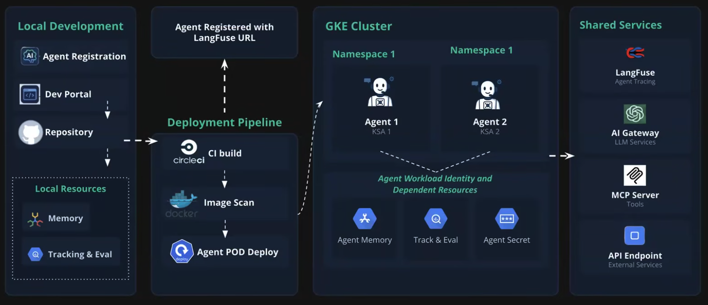
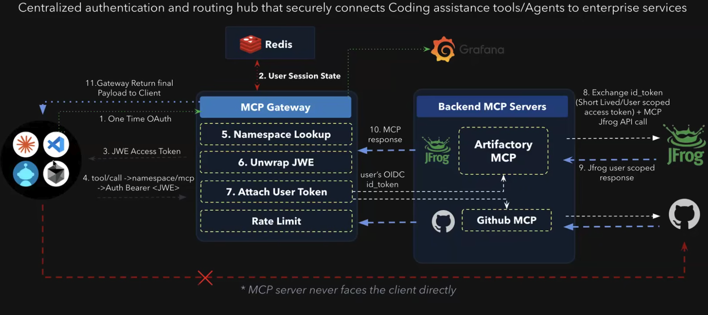
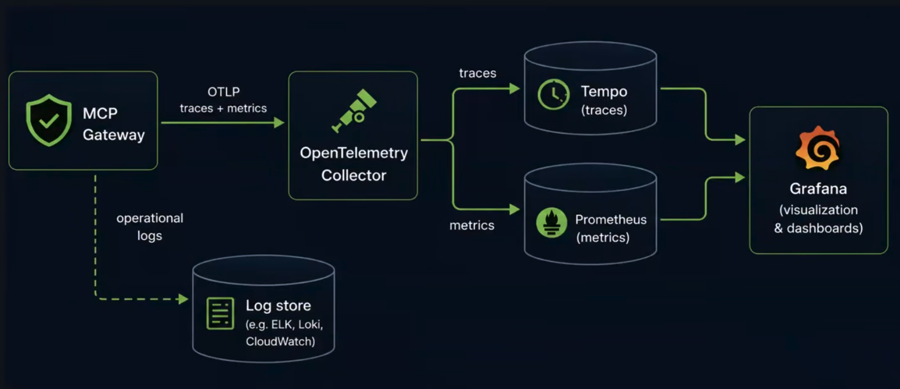
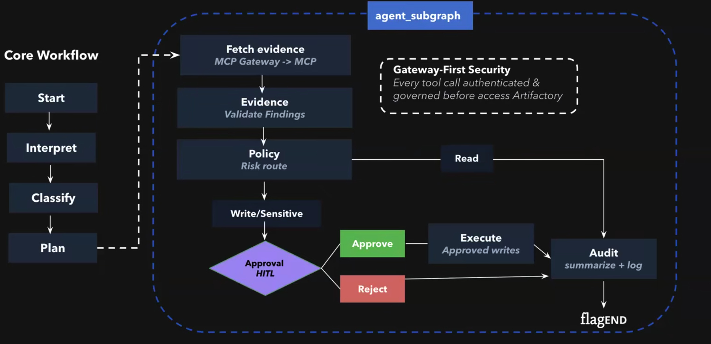
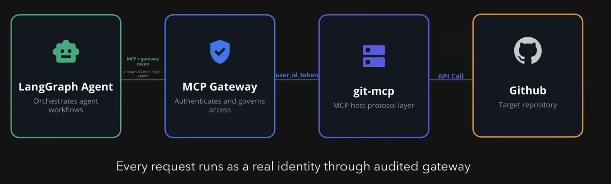

Design framework not just an Agent for solution

- **Agent Framework** : task specific notes with skills, prompts or internal marketplace pluggins
- **OAuth before every call** : each MCP tools call runs authenticated
- **Customized MCP** : MCP tools customized to internal security practices
- **Continuous Audit** : Every operations logged at MCP gateway
- **PII/Secrets stripped** : Sensitive data scrubbed before it reaches to LLM
- **Tracking and Eval** : Per-query tracking : Model , tokens, latency, response quality
- **Memory Management** : thread and checkpoints
- **Context Optimizer** : Trims and summarization context to cut unnecessary token spend

Each layer - scoped, sanitized, audited and measured by design

### MCP Server

A protocol layer that turns REST API into typed , perimission scoped tools an agent can call safely

- A FastMCP server exposes a set of typed tools
- Server enforces request filters , limits and blocked fields
- supports user or service-account identity via MCP Gateway

### MCP Gateway Monitoring and Compliance

Comprehensive telemetry, distributed tracing and real-time visualization for governed AI workflows.

### Agent Framework

Recommendation is Langraph

### One Governed Path - Agent - Oauth - Artifactory

