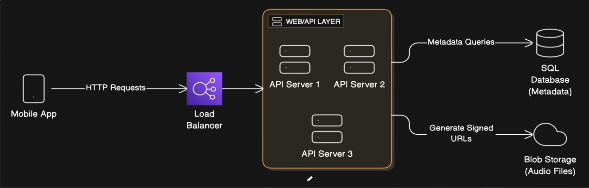
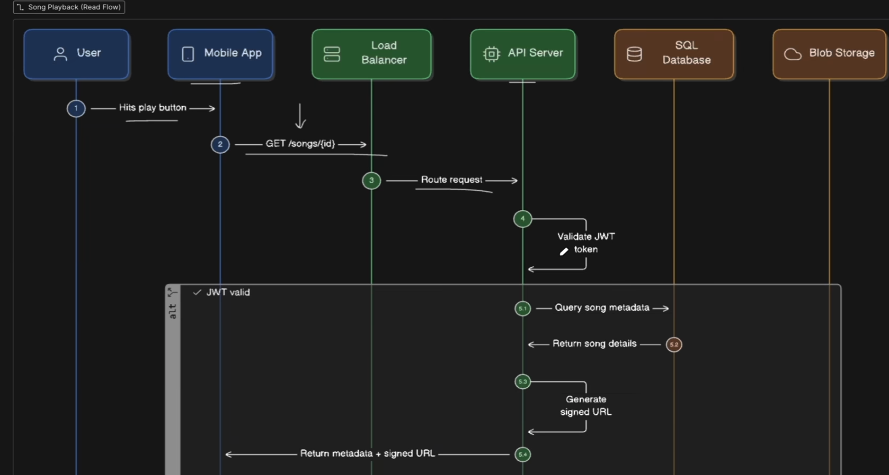
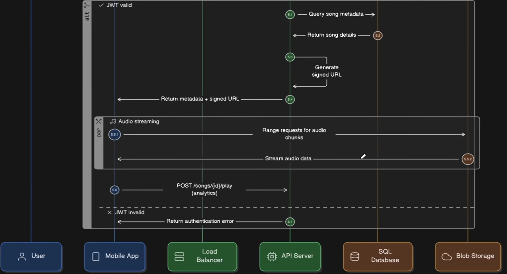

## The Approach

### Functional Requirements

- what are the main use cases?
- what is explicitly out of scope?
- who are the users and what platform?

### Non-Functional Requirements

- daily/monthly users? requests per second ?
- read-to-write ratio?
- Latency target : 200ms or sub-100ms
- Acceptable downtime ?

### Define Core Data and API's

Model what you're storing and how clients will interact with the system

#### Data Model

- main entities and relationships.
- primary keys, foreign keys, indexes
- which data needs strong consistency ?

#### API Design

- main and points with request/response formats
- pagination and error handling.
- rate limiting and versioning

#### Database Choice

- pick a database and justify it
- mention alternatives is considered
- walk through the trade-offs explicitly

### High Level Architecture

Design the component and show how data flows through them. Draw while you talk.

The components which are almost always present in a high level design

- **Database** : persistent writes and consistency
- **Load Balancer** : receives client requests
- **Cache Layer** : serves reads with TTL(time to live)
- **API Servers** : routes, reads and writes

Walkthrough both read and write paths. Explain async workflows, caching strategy with TTL and invalidation and CAP theorem trade-offs

### Bottlenecks, Scale and Reliability

This is the clearest signal separating mid-level from senior engineers

- Single points of failure , find them and propose solutions
- Fallbacks and Failures : Cache failure fallbacks, stale data over errors, partition handling
- Redundancy : Multi-AZ replicas , auto-scaling , distributed cache with replication
- Monitoring at p50/p95/p99 error rates queue depth, structured logs with request IDs

### Trade-offs and Extensions

- What did you prioritize ?
- What did you sacrifice ?

## Spotify System Design

### 1. Requirements and Assumptions

Roughly 500K users listening to about 30 million songs

The core requirements include

- artists can upload their songs
- users can search and play songs
- users can create and manage playlists
- users can maintain profiles
- basic monitoring and observability(health checks, error tracking, performance metrics)
- for audio formats we use Ogg and AAC files with different bit rates for adaptive streaming
- for example
  - 64 kbps for mobile data saving
  - 128 kbps for standard quality
  - 320 kbps for premium users
- on average one song file at normal audio quality takes about 3MB of storage

### 2. Capacity Planning

- Song Storage

  - 3MB \* 30M songs ~ 90TB of raw audio data.
  - this does not include replicas across different regions
  - it also doesn't include versioning over head when artists reupload songs
  - that's why we are looking at 2-3x this amount

- User metadata:

  - user profiles, comma preferences and playlist data are ~ 1KB \* 500K users = 0.5GB

- Song metadata:

  - each song needs a title, artist references, duration, file URLs and so on
  - a roughly 100 bytes per song \* 30 million songs ~ 3 GB
  - Practically nothing comparted to audio

- Daily bandwidth:
  - The average listen time is 3.5 minutes at 128-260kbps: thats roughly 3-4MB per stream
  - Lets assume each user streams 10-15 songs daily
  - This leads to significant egress costs

### 3. High Level architecture

- Load balancer is going to distribute between the API servers available
- In the web/api layer, we would have some sort of authentication like JWT tokens
- For metadata using SQL databases
- in order to access audio files, we are storing this audio files in blob storage And we will generate signed URLs to access the audio files, which are like short lived with a span of time
- Blob storage could be like s3 from AWS

