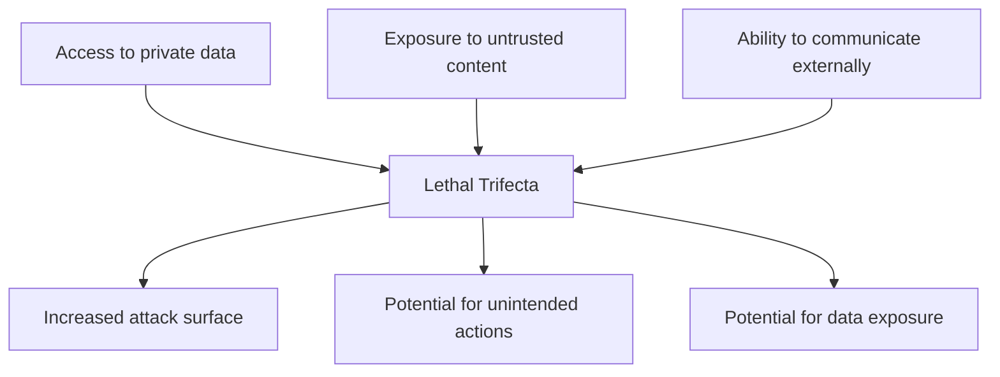
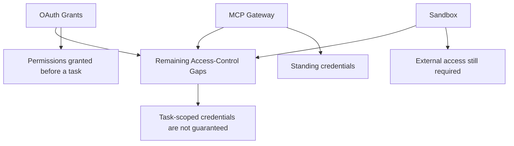
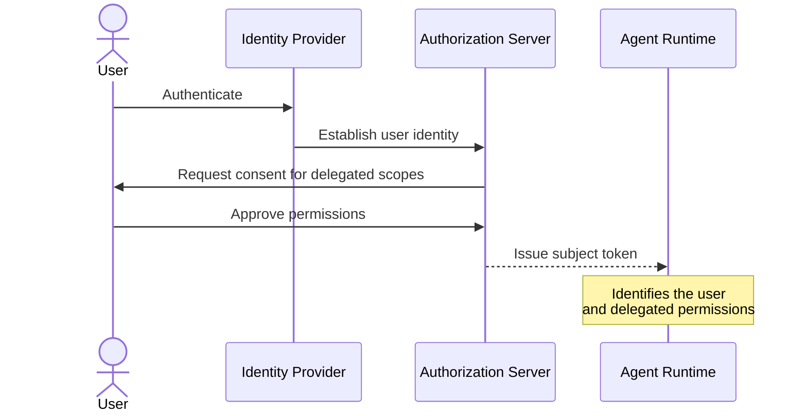
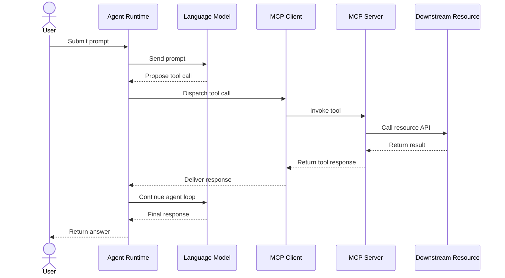
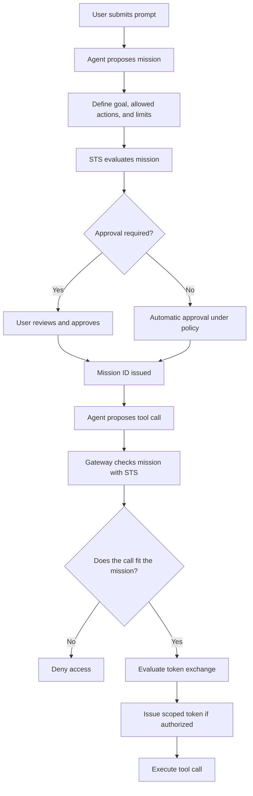
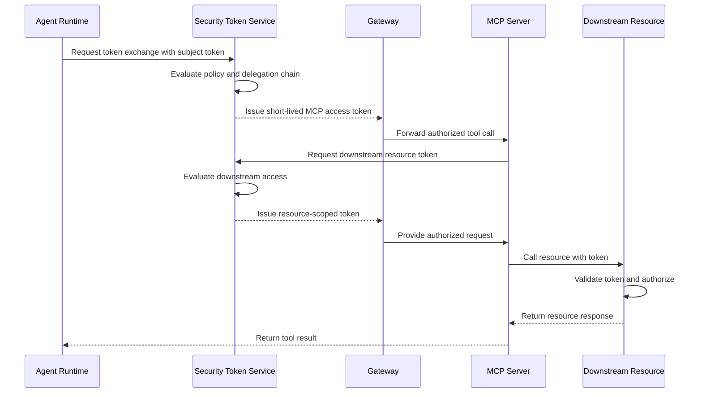
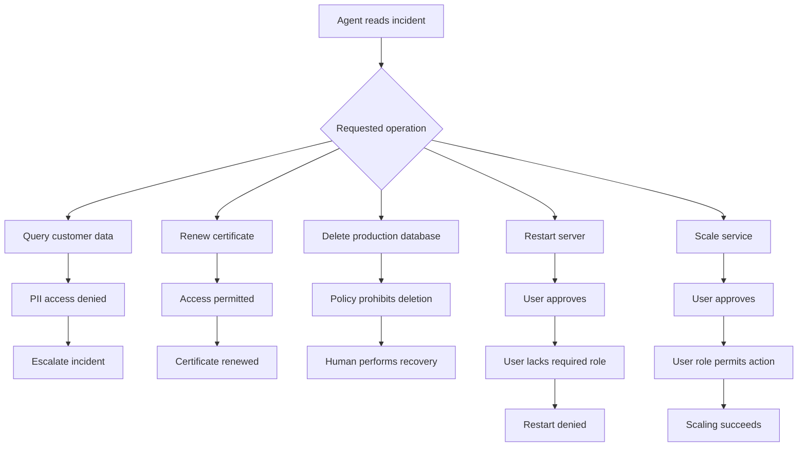

AI agents are becoming increasingly capable of reading private data, interacting with external services, and executing actions autonomously. These capabilities make them powerful, but they also introduce a fundamental security challenge: **How do we give an AI agent enough access to get work done without giving it more permissions than it actually needs?**

Consider an on-call triage agent responsible for reading incident tickets, resolving production issues, and escalating incidents that require human intervention. If this agent has unrestricted access to customer data, billing databases, and cloud infrastructure APIs, a single incorrect decision could expose sensitive information, delete production data, interrupt services, or incur unexpected costs.

The problem isn't just what an AI model generates. It's what the agent is authorized to do with its decisions.

In this article, I'll break down the lethal trifecta, explore the limitations of existing access-control approaches, and explain how token exchange, task-based authorization, and short-lived credentials can help secure agentic systems.

## 1. The Problem: When an AI Agent Has Too Much Access

Let's consider an on-call triage agent with access to four systems:

- An incident management API
- A customer data warehouse
- A billing database
- A cloud hosting API

The agent reads incoming tickets, decides what action to take, and either resolves the issue or escalates it to the morning team.

Now consider a few scenarios.

| Incident                                  | Agent action                                                     | Consequence or concern                                                    |
| ----------------------------------------- | ---------------------------------------------------------------- | ------------------------------------------------------------------------- |
| Billing anomaly                           | Queries customer records and includes them in an incident report | Personally identifiable information (PII) is exposed in the report.       |
| Backup power failure                      | Escalates the incident                                           | No additional service is called.                                          |
| Expiring TLS certificate                  | Calls the cloud hosting API to renew the certificate             | The agent successfully resolves the issue.                                |
| Broken billing database                   | Drops and restores the database                                  | A destructive production operation occurs, and recovery must be verified. |
| Frozen main server                        | Restarts the server                                              | Production is temporarily taken offline.                                  |
| Website failing for one in three visitors | Scales from four pods to forty                                   | Infrastructure costs increase by $420 per hour.                           |

Some of these actions are legitimate. Renewing an expiring certificate or scaling a service can be exactly what we want an agent to do.

The issue is that the same agent also has the ability to access customer records, delete production databases, and restart infrastructure.

The agent's permissions are not sufficiently constrained to the task it is performing. It uses static API keys and database connection strings, and its access can extend well beyond what an individual incident requires.

**The real challenge is to preserve the agent's autonomy while limiting its authority for each task.**

## 2. Understanding the Lethal Trifecta

An AI agent becomes particularly risky when three capabilities exist together:

1. Access to private data
2. Exposure to untrusted content
3. The ability to communicate externally

These three capabilities form the _lethal trifecta_, a concept attributed to Simon Willison.

### 2.1 Access to private data

Agents may access customer records, internal documents, email, CRM systems, data warehouses, and databases.

In our incident-triage example, the agent can query a customer data warehouse and interact with a billing database.

### 2.2 Exposure to untrusted content

Agents often process content they do not control, such as user-submitted tickets, external documentation, and reports generated by other agents.

The agent may use this content to determine what action to take.

### 2.3 Ability to communicate externally

Agents interact with APIs, MCP servers, and SaaS platforms to perform operations outside the language model itself.

These integrations allow agents to modify systems, access resources, and execute actions.

### The lethal trifecta

The difficulty is that these capabilities are also what make agents useful. Removing them entirely can significantly reduce an agent's usefulness.

Rather than removing capabilities indiscriminately, I believe the important design question is how to control the access associated with those capabilities.

## 3. Why Traditional Access-Control Approaches Are Not Enough

Three approaches are commonly considered when controlling access in agentic systems: OAuth grants, MCP gateways, and sandboxes.

Each addresses a different part of the problem, but none necessarily guarantees task-scoped credentials.

### 3.1 OAuth grants

OAuth allows a user to grant an application access to selected resources and permissions.

However, the permissions are typically granted before the specific agent task exists.

This creates a trade-off:

- A broad grant can leave the agent overprivileged for an individual task.
- A narrow grant can prevent the agent from completing useful work.

For example, an agent might receive both read and write permissions even though the current task only requires reading an incident ticket.

### 3.2 MCP gateways

An MCP gateway provides a centralized point for access enforcement, observability, and rate limiting.

However, the gateway may retain standing credentials that remain available beyond an individual task.

Evaluating a policy on every request is useful, but it does not automatically mean that the credentials themselves are restricted to the task.

### 3.3 Sandboxes

Sandboxes isolate execution and help contain the potential impact of a process.

However, agents still need access to external resources to perform useful work. Once they interact with those resources, authorization and credential management remain important.

A sandbox controls the execution environment, but it does not independently determine whether every external action is authorized.

### Comparison of access-control approaches

| Approach     | Primary benefit                                         | Limitation                                                           |
| ------------ | ------------------------------------------------------- | -------------------------------------------------------------------- |
| OAuth grants | Delegated permissions and user consent                  | Permissions may be too broad or too restrictive for a specific task. |
| MCP gateway  | Centralized enforcement, observability, and rate limits | Standing credentials may outlive the task.                           |
| Sandbox      | Execution containment                                   | External resource access still requires authorization.               |

Even when these approaches are combined, the agent may still lack credentials restricted to one specific task.

## 4. Token Exchange: Establishing Identity and Delegated Access

The next step is to establish who the agent is acting on behalf of and what permissions that user has delegated.

Token exchange is an existing standard that extends OAuth 2.0.

The process starts with user authentication. An identity provider and authorization server establish the user's identity and obtain consent for a subset of the user's permissions.

These permissions are represented as scopes.

The authorization server issues a token identifying the user and the access that has been delegated. This token is known as the **subject token**.

The subject token provides two important pieces of information:

- The identity of the user.
- The permissions delegated to the agent.

### Authentication and delegated permissions

This is an important improvement over an agent operating with an unidentified, static API key. Access can now be associated with a known user and the permissions delegated to the agent.

## 5. Following the Agent and MCP Execution Path

To understand where token exchange fits, let's follow a normal agent execution loop.

An agent runtime sends the user's prompt to a language model. The model proposes a tool call, which the MCP client dispatches to an MCP server.

The MCP server exposes defined tools and brokers access to downstream resources.

The response returns through the MCP server and client to the runtime, which can invoke the model again. This process repeats until the agent produces its final response.

### Agent execution flow

The critical change is that the agent should not simply use long-lived credentials whenever it proposes a tool call. Access should be mediated by an authorization mechanism that can evaluate the specific request.

## 6. The Security Token Service (STS)

A Security Token Service, or STS, is introduced to evaluate token-exchange requests and issue credentials when access is permitted.

When the agent proposes a tool call, the runtime authenticates with the STS using its application client credentials or workload identity. It also supplies the subject token identifying the user.

The authorization decision can consider:

- The identity of the requesting agent or application.
- The identity of the user on whose behalf it acts.
- The resource being requested.
- The permissions required for the operation.

The STS evaluates the request against governance policy and determines whether a token should be issued.

This introduces an important distinction: knowing that a user has access to a resource is not necessarily enough. The system also needs to evaluate whether the requested operation should be authorized in the context of the agent's work.

That distinction leads to task-based authorization and the proposed concept of intent-based authorization.

## 7. Intent-Based Authorization: Connecting Access to the Task

Intent-based authorization (IBA) is presented as an approach that checks what the agent intends to accomplish before allowing it to act.

It is important to distinguish this proposal from the task-based policy implementation used in the demonstration. IBA is presented as an approach still under development, rather than a finalized standard.

### 7.1 Define a mission

When a user submits a prompt, the agent proposes a mission containing:

- A goal.
- The allowed actions.
- The limits on those actions.

For example, consider a request to triage incident 2294.

The mission could allow the agent to read that ticket, summarize it, or escalate it. It would not allow the agent to read unrelated tickets or use unrelated services.

Now consider a request to remediate a usage spike. The mission might allow the agent to scale a service once, without granting access to other tools or APIs.

The second operation may be presented to the user for approval.

### 7.2 Associate tool calls with a mission

Once the mission is approved, the STS issues a mission ID.

The agent includes this ID in subsequent tool calls. A gateway checks with the STS to determine whether each requested action fits the approved mission.

If the request fits the mission and passes policy evaluation, token exchange can proceed.

### Intent-based authorization flow

The important idea is that the system evaluates access in the context of the task rather than relying exclusively on broad permissions granted in advance.

## 8. Ephemeral Credentials and Delegation Chains

Once the STS approves the request, it issues an access token for the MCP server.

These credentials are described as ephemeral: they should expire within minutes and should not be stored.

The token preserves the user's identity as the subject and identifies the application that performed the exchange. This creates a delegation chain that makes activity traceable.

### Downstream resource access

Some tools need to access resources beyond the MCP server itself.

In those cases, the MCP server requests another token exchange for the downstream resource. The STS evaluates the request against policy and issues a resource token if access is permitted.

The downstream resource validates the token and authorizes the operation. The token is then discarded rather than stored for later use.

### Token-exchange flow

The delegation chain makes it possible to trace the user and application associated with the request throughout the sequence of operations.

## 9. Validating the Design with Real Incident Scenarios

The architecture becomes clearer when applied to the original on-call triage example.

With authentication, an MCP server, an STS, and task-based policy in place, every request must pass through policy evaluation before credentials are issued.

The agent can still perform useful operations, but its access is now constrained.

### 9.1 Billing anomaly: Customer data is denied

The agent attempts to query the customer data warehouse.

Policy does not allow the required credentials to be issued because customer PII should not be included in the agent's context or in the incident ticket.

The agent proceeds without the customer data and escalates the incident.

### 9.2 Expiring certificate: Renewal succeeds

The agent requests access to the appropriate cloud hosting tool.

The STS grants access because the operation is permitted. The agent renews the certificate, and the audit log records the agent's request and the associated resource access.

### 9.3 Broken billing database: Destructive action is blocked

The agent determines that the recovery procedure involves dropping and restoring the production database.

Policy prohibits an agent from dropping a production database. The STS refuses to issue the required token, so a human must perform the recovery.

### 9.4 Frozen server: Approval is not enough

The agent proposes restarting the server, and the user approves.

However, the operation is blocked because the user's role does not provide the authority required to restart the server.

This is a crucial distinction: **user approval does not override the user's own authorization limits.**

### 9.5 Service scaling: Authorized action succeeds

The agent proposes scaling the service to address the website availability problem.

The user approves the operation, and the user's role permits it. Policy therefore allows the scaling operation to proceed.

### Summary of the outcomes

| Scenario            | Authorization decision                       | Result                               |
| ------------------- | -------------------------------------------- | ------------------------------------ |
| Billing anomaly     | Deny access to customer PII                  | Escalate without customer data.      |
| Certificate renewal | Permit                                       | Certificate is renewed.              |
| Database deletion   | Deny                                         | Human performs recovery.             |
| Server restart      | Deny because the user's role lacks authority | Restart is blocked despite approval. |
| Service scaling     | Permit after approval                        | Scaling succeeds.                    |

## 10. Key Takeaways

The design demonstrates several important principles for agentic systems.

**Identity must be explicit.** The system should know which user the agent is acting for and which application is requesting access.

**Permissions should be task-scoped.** The agent should not automatically inherit broad standing access for every task it performs.

**Credentials should be short-lived.** Ephemeral tokens reduce the need to retain credentials beyond the operation for which they were issued.

**Policy must govern execution.** The agent's decision to call a tool is not sufficient authorization to execute that call.

**Human approval must respect authorization boundaries.** A user cannot approve an action that their role does not permit.

**Auditability matters.** The delegation chain should make it possible to trace actions to the user and application involved.

**Agent capabilities can be retained.** The goal is not to remove the agent's ability to read data, use tools, or act autonomously. It is to control how and when those capabilities can be exercised.

## Conclusion

The lethal trifecta highlights a fundamental challenge in agentic AI: the capabilities that make agents useful can also make them dangerous when combined with excessive permissions.

The on-call triage example illustrates the consequences of unrestricted access, from exposing customer data to deleting production databases and incurring unexpected infrastructure costs.

A more controlled design establishes the user's identity, delegates a subset of permissions, mediates tool access through an MCP server, and uses a Security Token Service to issue short-lived credentials after policy evaluation.

Task-based authorization constrains access to the work being performed, while intent-based authorization proposes an additional way to connect permissions to the agent's declared mission.

The overall flow is:

**Overprivileged agent → authenticated identity → delegated permissions → token exchange → task-based policy → short-lived credentials → authorized execution → auditable results.**

The goal is straightforward: preserve the usefulness and autonomy of AI agents while ensuring that every action is constrained by the authority granted to the agent for the task at hand.
